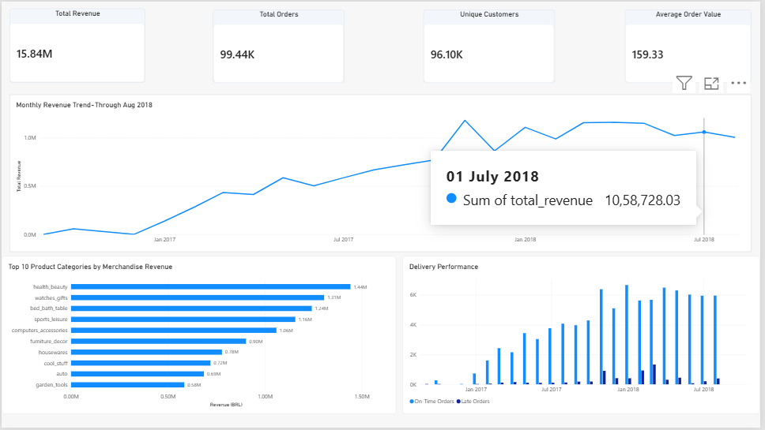
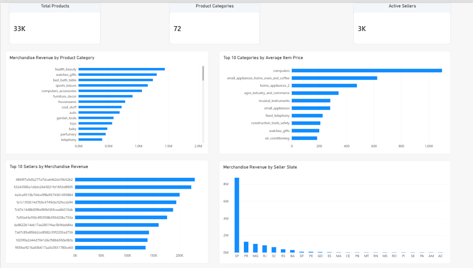
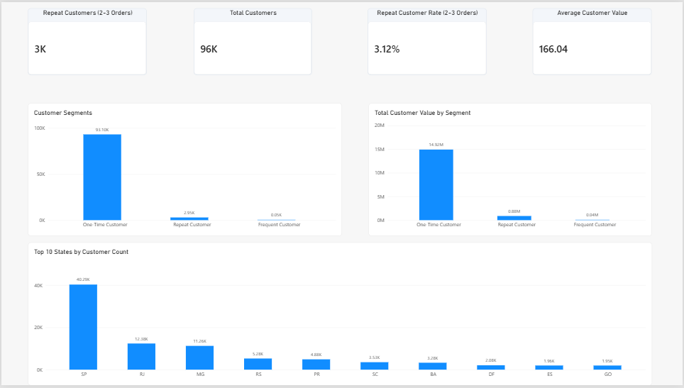
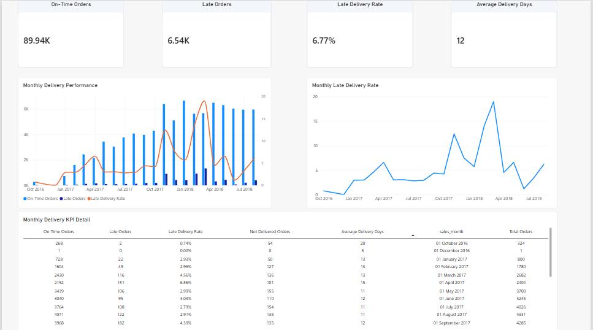
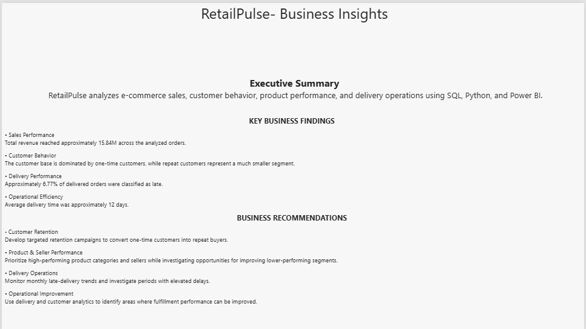

# RetailPulse — E-Commerce Sales & Business Analytics

RetailPulse is an end-to-end e-commerce analytics project built using the Olist Brazilian E-Commerce Public Dataset.

The project transforms raw transactional data into validated PostgreSQL datasets, reusable SQL analytical views, Python exploratory analysis, and an interactive Power BI dashboard.

---

## Project Objective

RetailPulse analyzes:

- Sales and revenue performance
- Product category performance
- Seller performance
- Customer purchasing behavior
- Customer segmentation
- Payment behavior
- Delivery performance

The project demonstrates an end-to-end analytics workflow from raw data validation to business reporting and insights.

---

## Tech Stack

- **Database:** PostgreSQL
- **SQL:** PostgreSQL
- **Programming:** Python
- **Data Analysis:** Pandas, NumPy
- **Visualization:** Matplotlib, Seaborn
- **Business Intelligence:** Power BI
- **Testing:** pytest
- **Database Connectivity:** SQLAlchemy, psycopg2

---

## Dataset

The project uses the **Olist Brazilian E-Commerce Public Dataset**.

The dataset contains approximately 100K orders across multiple related datasets covering:

- Customers
- Orders
- Order items
- Payments
- Reviews
- Products
- Sellers
- Geolocation
- Product category translations

Raw datasets are intentionally excluded from the repository.

---

## Project Architecture

```text
Raw E-Commerce Data
        |
        v
Data Inspection
        |
        v
Data Validation
        |
        v
PostgreSQL
        |
        v
SQL Staging
        |
        v
SQL Transformations
        |
        v
Business Analysis
        |
        v
Reporting Views
       /       /        v     v
 Python   Power BI
   EDA    Dashboard
     \     /
      \   /
       v v
 Business Insights
```

---

## Repository Structure

```text
retailpulse/
│
├── data/
│   ├── raw/
│   └── processed/
│
├── sql/
│   ├── schema/
│   ├── staging/
│   ├── transformations/
│   ├── analysis/
│   └── views/
│
├── src/
│   ├── data/
│   ├── analysis/
│   └── visualization/
│
├── notebooks/
│   └── 01_retailpulse_eda.ipynb
│
├── powerbi/
│   ├── screenshots/
│   │   ├── 01_executive_overview.png
│   │   ├── 02_product_sales.png
│   │   ├── 03_customer_analysis.png
│   │   ├── 04_delivery_operations.png
│   │   └── 05_insights_summary.png
│   └── RetailPulse_Dashboard.pbix
│
├── results/
│   ├── monthly_sales.csv
│   ├── category_sales.csv
│   ├── seller_sales.csv
│   ├── customer_segments.csv
│   └── monthly_delivery.csv
│
├── scripts/
│   └── export_results.py
│
├── tests/
│
├── README.md
├── requirements.txt
└── .gitignore
```

---

## Data Validation

Before loading the datasets into PostgreSQL, the raw data was inspected and validated.

Validation includes:

- Primary-key uniqueness
- Foreign-key integrity
- Null-value checks
- Valid order statuses
- Valid review scores
- Non-negative monetary values
- Date parsing and consistency

Automated pytest tests are included for these validation rules.

---

## PostgreSQL Data Model

The PostgreSQL database contains the following source tables:

- `customers`
- `geolocation`
- `order_items`
- `order_payments`
- `order_reviews`
- `orders`
- `products`
- `sellers`
- `category_translation`

The SQL layer builds reusable analytical views on top of these source tables.

---

## SQL Analytics

The SQL pipeline is organized into four layers.

### 1. Staging

Creates standardized fields and reusable calculations such as:

- Order purchase date
- Order purchase month
- Delivery days
- Delivery performance
- Item total value
- Freight percentage
- Payment behavior

### 2. Transformations

Creates reusable analytical datasets:

- `fact_orders`
- `dim_customers`
- `dim_products`
- `dim_sellers`
- `order_item_summary`
- `order_payment_summary`

### 3. Business Analysis

The analysis layer covers:

- Monthly sales
- Category sales
- Seller sales
- Delivery performance
- Delivery KPIs
- Customer behavior
- Customer segmentation
- Payment analysis
- Order payment behavior

### 4. Reporting

Power BI-ready reporting views include:

- `rpt_sales_dashboard`
- `rpt_category_dashboard`
- `rpt_seller_dashboard`
- `rpt_customer_dashboard`
- `rpt_delivery_dashboard`

---

## Python Analysis

The Python notebook performs exploratory analysis of:

- Monthly sales
- Product category performance
- Customer purchasing behavior
- Delivery performance

Reusable analysis and visualization functions are maintained under:

```text
src/analysis/
src/visualization/
```

### Key Findings

- Approximately **99K orders**
- Approximately **15.84M BRL** in total revenue
- Customers with more than one order represent approximately **3.12%** of customers
- Approximately **6.77%** of delivered orders were classified as late
- Average delivery time is approximately **12 days**

---

## Power BI Dashboard

The Power BI dashboard contains five pages.

### 1. Executive Overview

Provides high-level KPIs and monthly sales performance.

Key metrics include:

- Total Revenue
- Total Orders
- Unique Customers
- Average Order Value
- Monthly Revenue Trend
- Top Product Categories
- Delivery Performance

### 2. Product & Sales Analysis

Analyzes:

- Product categories
- Average item prices
- Top sellers
- Seller-state performance

### 3. Customer Analysis

Analyzes:

- Customer segments
- Customer value
- Repeat customers
- Customer distribution by state

Customer segmentation:

- **One-Time Customer:** 1 order
- **Repeat Customer:** 2–3 orders
- **Frequent Customer:** 4+ orders

### 4. Delivery & Operations

Analyzes:

- On-time vs late orders
- Monthly delivery performance
- Late-delivery rate
- Average delivery time
- Monthly delivery KPIs

### 5. Insights & Summary

Summarizes the major business findings and business recommendations derived from the analysis.

---

## Dashboard Preview

### Executive Overview



### Product & Sales Analysis



### Customer Analysis



### Delivery & Operations



### Insights & Summary



---

## Key Business Insights

### Sales Performance

The dataset contains approximately 99K orders generating approximately **15.84M BRL** in total item and freight revenue.

### Customer Behavior

The customer base is predominantly composed of one-time customers, while customers placing multiple orders represent a much smaller segment.

### Delivery Performance

Approximately **6.77% of delivered orders** were classified as late.

### Operations

Average delivery time across delivered orders is approximately **12 days**.

---

## Analytical Results

Selected analytical outputs are exported to the `results/` directory:

- `monthly_sales.csv`
- `category_sales.csv`
- `seller_sales.csv`
- `customer_segments.csv`
- `monthly_delivery.csv`

These outputs provide reproducible snapshots of the project's analytical layer.

---

## Running the Project

### 1. Create a virtual environment

```bash
python -m venv .venv
```

Activate it on Windows:

```bash
.venv\Scripts\activate
```

### 2. Install dependencies

```bash
pip install -r requirements.txt
```

### 3. Configure PostgreSQL

Create a PostgreSQL database named:

```text
retailpulse
```

Create a `.env` file in the project root:

```text
DB_HOST=localhost
DB_PORT=5432
DB_NAME=retailpulse
DB_USER=postgres
DB_PASSWORD=YOUR_PASSWORD
```

Do not commit `.env` to Git.

### 4. Load the dataset

Place the Olist CSV files inside:

```text
data/raw/
```

Run the project's data-loading pipeline.

### 5. Run automated tests

```bash
pytest -v
```

### 6. Run Python EDA

Open:

```text
notebooks/01_retailpulse_eda.ipynb
```

Run the notebook cells.

### 7. Export analytical results

```bash
python scripts/export_results.py
```

---

## Testing

The project uses `pytest` for automated validation.

Tests cover:

- Data validation
- Primary-key uniqueness
- Foreign-key integrity
- Domain validation
- Date parsing
- PostgreSQL schema integrity
- Project structure

Run:

```bash
pytest -v
```

---

## Business Use Cases

RetailPulse demonstrates how an analytics workflow can be used to:

- Monitor revenue trends
- Identify high-performing product categories
- Analyze seller performance
- Understand customer retention patterns
- Monitor delivery performance
- Analyze payment behavior
- Support operational decision-making

---

## Conclusion

RetailPulse demonstrates an end-to-end analytics workflow from raw transactional data to validated PostgreSQL datasets, SQL-based business analysis, Python exploratory analysis, and interactive Power BI reporting.

The project combines data validation, relational data modeling, SQL analytics, exploratory analysis, visualization, testing, and business reporting into a reproducible analytics workflow.
